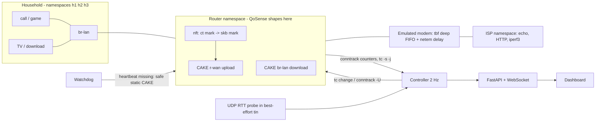

# Architecture

## Control tick (500 ms): sense, decide, act, verify
1. **Sense.** `conntrack -L -o extended` (packet/byte counters), `tc -s -j qdisc` (per-tin stats), UDP RTT probe.
2. **Classify.** `FlowTracker` turns counter deltas into 9 behavioural features; `StableClassifier` applies
   hysteresis (3 agreeing votes), user pins and a confidence fallback to the rules.
3. **Estimate.** One `CapacityEstimator` per direction. Delay above 15 ms while busy lowers the rate (max -15% per tick);
   idle headroom probes up (+5%). CUSUM on the delay flags a cliff and widens the decrease clamp to -50%.
4. **Decide.** `policy.decide` is a pure function: classes + active intents + rates -> ct marks and shaper rates.
   Bulk floor: if latency-sensitive flows would take more than 95% of traffic, the heaviest is demoted.
5. **Act.** `Enforcer` runs `tc qdisc change` and `conntrack -U -m <mark>`, with retries (backoff + jitter) and a circuit breaker.
6. **Verify.** After a >5% rate change, the 10 s p95 RTT is compared with the pre-change p95; worse by >25% means rollback and a 5 s cooldown.

## Why shaping sits on the router's veth egresses
On a real WAN, tc *ingress* runs before nftables, so the packet mark is not yet set when traffic is redirected to
an IFB device. In the lab the download CAKE is on the LAN-facing egress (`br-lan`) where the mark exists. For
production on a real WAN, use `tc filter ... ingress matchall action ctinfo cpmark 0x0f action mirred egress redirect dev ifb0`.

## ct mark -> CAKE tin
`cake ... diffserv4 fwmark 0x0f`: mark value *n* (1-based) selects tin *n* in tc's display order:
1 Bulk, 2 Best Effort, 3 Video, 4 Voice, 0 = no override (use DSCP). Derived from kernel `tin_order` logic and
**asserted in CI** (`tests/ci/test_tin_mapping.sh`) from per-tin packet counters.

## Failure handling
| Failure | Behaviour |
|---|---|
| Controller crashes or hangs | Watchdog sees a stale heartbeat (>1.5 s), flushes the mark rule and applies static CAKE |
| tc/conntrack call fails | Retry with backoff; after 3 failures the breaker opens, last-known-good state is held, dashboard shows it |
| Rate change makes latency worse | Verifier rolls back |
| Late tick | Skipped, never queued (400 ms budget) |
| Model missing or unsure | Falls back to the rule classifier |
| Visitor abuse | Token-bucket per IP; scenarios time-boxed and auto-reset; WebSocket cap |

## Scale-out story
One controller per gateway; the cloud only receives per-class aggregates (a handful of series), never per-flow data.
The production path swaps `conntrack` polling for eBPF/XDP counters and `tc` shelling for netlink.
